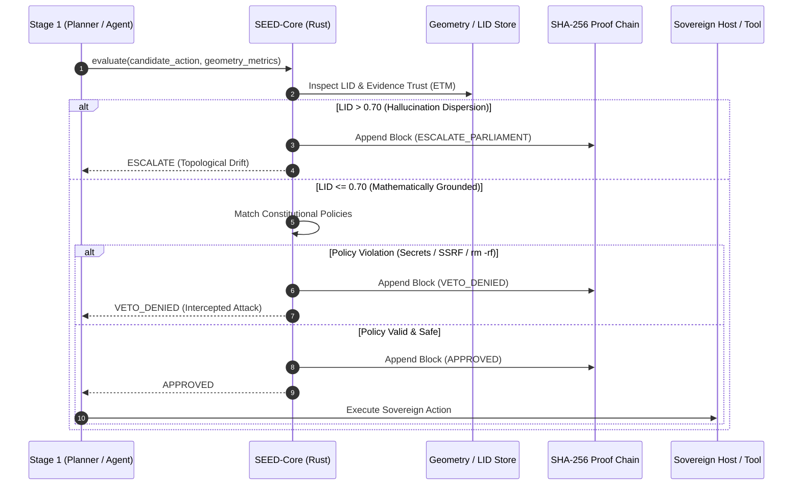

# SEED-Core Deep Architecture Guide

This document provides a technical walkthrough of **SEED-Core's** internal subsystems, decision lifecycle, mathematical geometry, and cryptographic proof engine.

---

## 1. System Overview & Component Topology

SEED-Core is implemented as a high-performance native Rust library (`seed_core`), CLI binary, and C-FFI shared library:

```
 ┌───────────────────────────────────────────────────────────────┐
 │                   Language SDKs & Interfaces                  │
 │   CLI Binary  │  Python SDK (C-FFI)  │  Tokio IPC (Socket/TCP)│
 └───────┬───────────────────┬──────────────────────┬────────────┘
         │                   │                      │
         └───────────────────┼──────────────────────┘
                             ▼
 ┌───────────────────────────────────────────────────────────────┐
 │                     Stage-2 Decision Engine                   │
 │                                                               │
 │   ┌──────────────────────┐         ┌──────────────────────┐   │
 │   │  Candidate Validator │         │ Topological Geometry │   │
 │   │  (Input Sanitizer)   │         │ (LID Hallucination)  │   │
 │   └──────────┬───────────┘         └──────────┬───────────┘   │
 │              │                                │               │
 │              └────────────────┬───────────────┘               │
 │                               ▼                               │
 │                 ┌───────────────────────────┐                 │
 │                 │ Constitutional Evaluator  │                 │
 │                 │ - HOST_SOVEREIGN Guard    │                 │
 │                 │ - OFFLINE_STRICT Sandbox  │                 │
 │                 │ - Streak Loop Detector    │                 │
 │                 └─────────────┬─────────────┘                 │
 │                               ▼                               │
 │                 ┌───────────────────────────┐                 │
 │                 │ SHA-256 Proof Recorder    │                 │
 │                 │ (Tamper-Evident Chain)    │                 │
 │                 └───────────────────────────┘                 │
 └───────────────────────────────────────────────────────────────┘
```

---

## 2. Decision Lifecycle

Each decision flows through a linear, non-blocking evaluation pipeline:



---

## 3. Mathematical Geometry: Local Intrinsic Dimensionality (LID)

### The Problem
Large Language Models exhibit "hallucination clouds" when uncertain. In topological vector space, when an LLM plans outside its domain competence, proposed action concepts scatter across unrelated submanifolds with high dimensional dispersion.

### The LID Formulation
SEED-Core implements the **Maximum Likelihood Estimator** for Local Intrinsic Dimensionality (Levina-Bickel formulation) over cosine pseudo-distances:

1. Let $x$ be the candidate intent embedding and $N_k(x) = \{x_1, \dots, x_k\}$ be its $k$-nearest neighbors in episodic memory.
2. We map cosine similarity $\cos(x, x_i)$ to pseudo-distance $d(x, x_i) = 1 - \cos(x, x_i)$.
3. Let $r_k = d(x, x_k)$ be the maximum distance to the $k$-th neighbor.
4. The raw LID is estimated as:
   $$\widehat{\text{LID}}_k(x) = -\left[ \frac{1}{k-1} \sum_{i=1}^{k-1} \ln \frac{d(x, x_i)}{r_k} \right]^{-1}$$
5. The normalized metric is clamped to $[0.05, 0.99]$.
   - **$\text{LID} \le 0.45$:** High confidence, dense topological neighborhood.
   - **$0.45 < \text{LID} \le 0.70$:** Moderate uncertainty, acceptable under safe policy.
   - **$\text{LID} > 0.70$:** **Hallucination Cloud Triggered.** Immediate `ESCALATE_PARLIAMENT` verdict before any destructive action is attempted.

---

## 4. Cryptographic Proof Chain Specification

Every decision forms an immutable, tamper-evident block linked via SHA-256:

$$\text{Block}_n = \text{SHA-256}\Big(\text{Block}_{n-1} \,\|\, \text{StepID} \,\|\, \text{Verdict} \,\|\, \text{Target} \,\|\, \text{Timestamp}\Big)$$

```json
{
  "step_id": 42,
  "verdict": "VetoDenied",
  "action": "Refuse",
  "confidence": "High",
  "reason": "VETO: access or exfiltration of protected secret [id_rsa] strictly denied",
  "latency_us": 14,
  "audit_hash": "efc10d9f5dd96faeffa39657c91a0284b39b56f8f553a1a97d4dfbf3a9484b2c",
  "timestamp": "2026-10-18T08:04:05.264Z"
}
```

This guarantees **non-repudiation**: any post-facto modification or deletion of a decision log invalidates the cryptographic root of the chain.

---

## 5. IPC Architecture: Tokio Asynchronous Daemon

SEED-Core provides high-throughput IPC daemon capabilities via `seed-core serve`:
- **Unix Domain Sockets (`/tmp/seed-core.sock`)**: Sub-20 µs local IPC for co-located processes (e.g. Node.js Viper Chat agent).
- **TCP Sockets (`127.0.0.1:4040`)**: Low-overhead loopback networking for containerized agent environments.
- **Protocol**: Line-delimited JSON (`JSONL`) stream with concurrent request handling powered by Tokio workers.
