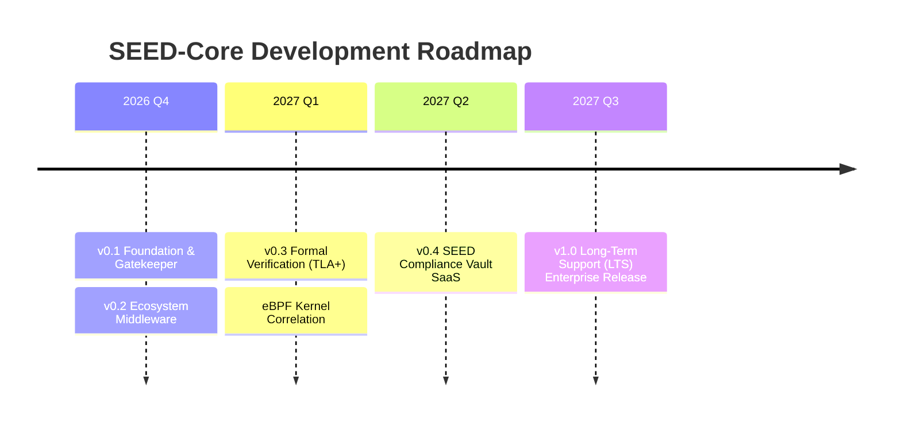

# SEED-Core Product & Technical Roadmap

This document outlines the architectural milestones and planned release schedule for **SEED-Core**.

---

## 🧭 Milestone Overview

---

## 📌 Release Schedule & Capabilities

### ✅ v0.1.x — Native Core & Gatekeeper Foundation *(Current)*
- [x] Sub-15 microsecond deterministic Rust decision engine.
- [x] Operational profiles: `HOST_SOVEREIGN` (unshackled host operations) and `OFFLINE_STRICT`.
- [x] Topological hallucination detection via Local Intrinsic Dimensionality (LID).
- [x] Cryptographic SHA-256 proof block chain with non-repudiation.
- [x] Official Python SDK (`seed-core`) with native C-FFI and wheel distribution.
- [x] Asynchronous Tokio IPC daemon (Unix Domain Sockets & TCP).
- [x] Automated CI with `cargo-audit` supply chain dependency scanning.
- [x] Formal threat model, LLM benchmark study, and EU AI Act / SOC2 compliance mapping.

---

### 🚀 v0.2.0 — Ecosystem Middleware & Multi-Language SDKs *(Q4 2026)*
- [ ] **LangChain / LangGraph Middleware:** Pre-built `SeedCoreCallbackHandler` and `SeedToolValidator`.
- [ ] **LlamaIndex Integration:** Native query engine guardrail extension.
- [ ] **TypeScript / Node.js SDK:** Native N-API bindings (`@seed-core/client`) for JavaScript agent frameworks.
- [ ] **Cross-Platform Pre-built Wheels:** Automated binary wheels for macOS (Apple Silicon / Intel) and Windows x86_64.
- [ ] **Dynamic Policy Hot-Reloading:** Reload constitutional regex patterns without daemon restarts.

---

### 🛡️ v0.3.0 — Formal Verification & Kernel Correlation *(Q1 2027)*
- [ ] **Formal Verification (TLA+ / Coq):** Mathematically proven state invariants for the JFP constitutional gatekeeper to guarantee absence of deadlock and privilege escalation.
- [ ] **eBPF Kernel Sensor Integration:** Correlate userspace Stage-2 decisions with actual Linux kernel syscall execution events in real time.
- [ ] **Multi-Manifold Adaptive LID:** Automatic domain manifold detection for hybrid multimodal embeddings.
- [ ] **Hardware-Enforced Cryptography:** Optional hardware TPM 2.0 / Nitro Enclave sealing of the audit chain root.

---

### ☁️ v0.4.0 — SEED Compliance Vault SaaS *(Q2 2027)*
- [ ] **Centralized Enterprise Dashboard:** Real-time telemetry streaming from distributed SEED-Core instances.
- [ ] **One-Click Compliance Reporting:** Automated generation of certified PDF audit reports for EU AI Act, SOC2 Type II, and ISO/IEC 42001 audits.
- [ ] **Fleet-Wide Parliament Escalation:** Webhook and Slack/PagerDuty routing for human-in-the-loop escalation events.

---

### 🏛️ v1.0.0 — Enterprise Long-Term Support (LTS) *(Q3 2027)*
- [ ] **API Stability Guarantee:** Strict backwards compatibility guarantee for Rust C-ABI and Python SDKs.
- [ ] **Pre-Audited Vertical Profiles:**
  - `FINTECH_PCI_DSS`: Guardrails for banking and automated financial transactions.
  - `HEALTHCARE_HIPAA`: Strict patient data and PHI exfiltration filters.
  - `DEVSECOPS_SOVEREIGN`: Hardened CI/CD infrastructure deployment rules.
- [ ] **Enterprise 24/7 SLA:** Production commercial support contracts with dedicated engineering escalation paths.

---

## 💡 Contributing to the Roadmap
To propose new features, constitutional profiles, or benchmark workloads, please open a thread on **[GitHub Discussions](https://github.com/jarohull-ai/seed-core/discussions)** or submit an issue referencing `ROADMAP.md`.
